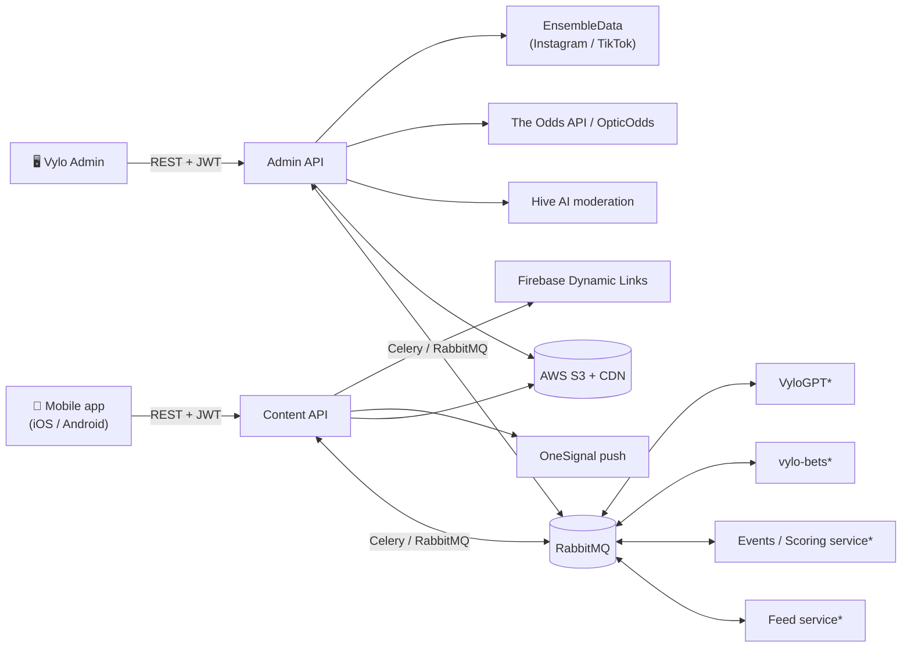
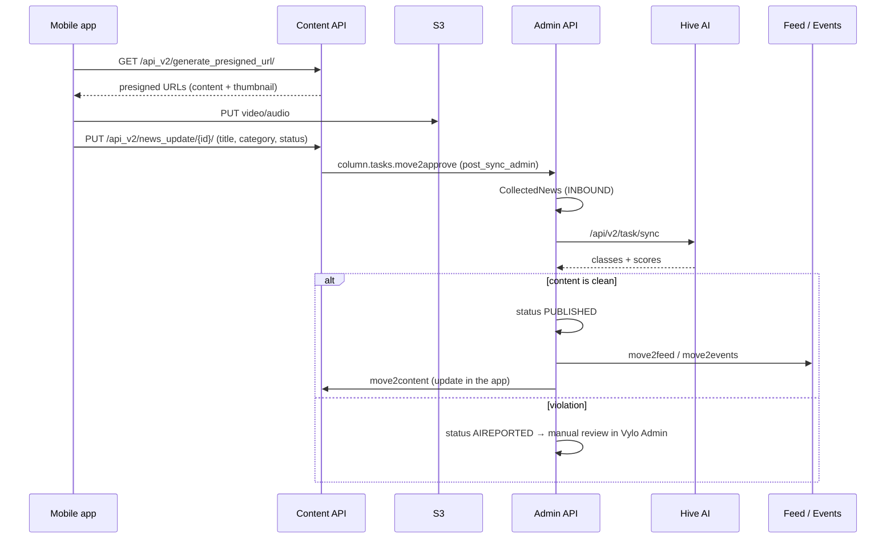

# 0. Ecosystem Overview

[← Contents](README.md)

This repository is one part of **Vylo** (internal code name **Column**). Vylo is a sports-focused social mobile app. It has a news feed from
publishers, video and audio posts from users, comments and replies, and follows for authors and categories. It also has a DFS module
called **Vylo Props**: over/under picks on player stats, lineups, balances, promo codes and Creator Cash.

## Services

| Service | Repository | Role | Stack |
|---|---|---|---|
| **Content API** | `content-api` | Mobile app backend: auth, profiles, follows, user posts, comments, media upload | Django 3.2, DRF, Celery, PostgreSQL, S3 |
| **Admin API** | `column-admin-api` | Admin backend: content moderation, news publishing, AI moderation (Hive), scrapers, odds, Vylo Props mirror | Django 3.2, DRF, Celery, PostgreSQL, S3 |
| **Vylo Admin** | `column-admin` | Admin web SPA on top of the Admin API | React 18, TypeScript, Vite, TanStack Query |
| Feed service* | — | Builds user feeds | — |
| Events / Scoring service* | — | Events, post scores, push notifications | — |
| vylo-bets* | — | Vylo Props engine: props, lineups, balances, payments | — |
| VyloGPT* | — | AI predictions for sports events | — |

`*` These services live in other repositories. What we know about them comes only from the task names and queues that the three repositories above send to.

## High-level architecture

The services do not call each other over HTTP. They exchange events through **RabbitMQ using Celery**
(`app.send_task('<task name>', queue='<queue>')`). Each service has its own PostgreSQL database and keeps a local copy of the
entities it needs (profiles, categories, posts). Tasks keep those copies in sync.



## Main RabbitMQ queues

| Queue | Consumer | Purpose |
|---|---|---|
| `app` | Content API | Import news, categories and profiles from the admin into the app |
| `post_sync_column` | Content API (dedicated worker) | Post synchronization into Content API |
| `admin` | Admin API | Regular admin tasks: reports, scores, comments, Vylo Props sync |
| `post_sync_admin` | Admin API (dedicated worker) | Receives new user posts from Content API for moderation |
| `feed`, `post_sync_feed` | Feed service | Feed building |
| `events`, `post_sync_events` | Events service | Events, scoring, push notifications |
| `lineup_priority` | vylo-bets | Lineup data requests for posts |
| `vylo-bets`, `admin_to_main_tasks` | vylo-bets | Sends admin changes (balance, picks, restrictions) back to vylo-bets |
| `vylogpt` | VyloGPT | Prediction generation for sports events |

## End-to-end: lifecycle of a user post



## Environments

| Branch | Environment |
|---|---|
| `develop` | Dev |
| `staging` / `aws-staging` | Staging |
| `master` | Production |

## Shared local infrastructure

The backends expect PostgreSQL and RabbitMQ on an external Docker network called `backend`. A minimal compose file for local development:

```yaml
# docker-compose.infra.yaml — local development only
services:
  postgres:
    image: postgres:16
    environment:
      POSTGRES_USER: <user>
      POSTGRES_PASSWORD: <password>
    ports: ["5432:5432"]
    networks: [backend]
  rabbitmq:
    image: rabbitmq:3-management
    environment:
      RABBITMQ_DEFAULT_USER: <user>
      RABBITMQ_DEFAULT_PASS: <password>
      RABBITMQ_DEFAULT_VHOST: <vhost>
    ports: ["5672:5672", "15672:15672"]   # AMQP, management UI
    networks: [backend]
networks:
  backend:
    external: true
```

```sh
docker network create backend
docker compose -f docker-compose.infra.yaml up -d
```
