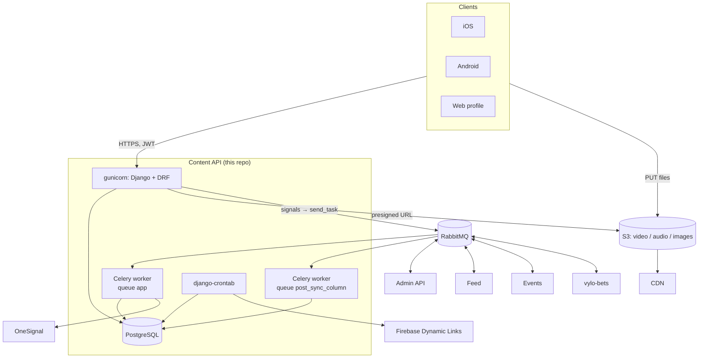
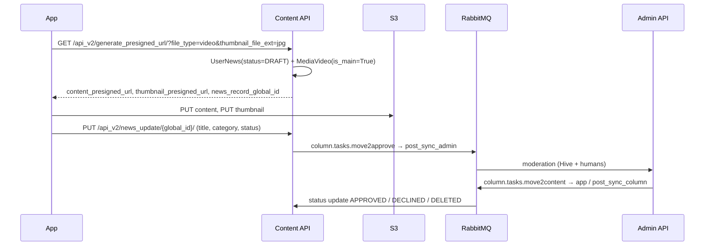

# 2. Architecture

[← Contents](README.md)

## Place in the ecosystem

Content API is the client-facing backend for the mobile apps. It is **not** the source of truth for all content. Publisher news,
categories, moderation statuses and curated posts come from the Admin API through Celery. Content API **is** the source of truth for
users, profiles, follows, reports and blocks, and it publishes that data to the other services.



## Runtime processes

| Process | Command | Role |
|---|---|---|
| **web** | `entrypoint.sh`: `migrate`, `collectstatic`, `crontab add`, `gunicorn column.wsgi -w 3` | HTTP API on `:8000` |
| **celery** | `celery.sh`: `celery -A column worker -Q app` | Imports from the admin, OneSignal, lineups |
| **celery_post_sync_column** | `celery_post_sync.sh`: `-Q post_sync_column --concurrency=4` | Dedicated post-sync worker, so other tasks can't hold up post imports |
| **cron** (inside web) | `django-crontab` | See [section 6](06-async-and-integrations.md#periodic-jobs-cron) |

## Application layers

```
HTTP request
   │
   ▼
urls.py (column/urls.py → api/urls.py, api/versioned/v2/urls.py, api_v2/urls.py)
   │
   ▼
views (DRF generic views / APIView)         ← permission_classes, pagination
   │
   ▼
serializers                                 ← validation, create/update business logic
   │
   ▼
models (Django ORM)                         ← save() invariants (cross-table global_id uniqueness)
   │
   ▼
signals (post_save / m2m_changed / post_delete)
   │
   ▼
app.send_task(...) → RabbitMQ → other services
```

Most business logic lives in **serializers** (create/update/validate) and **signals** (sync). There is no separate service layer.

## Cross-service identity

Every entity that crosses service boundaries has a `global_id` (UUID). Local auto-increment `id`s are only meaningful inside one
database. All inter-service messages and most URLs use `global_id`.

## Two generations of the content model

Two post models exist side by side in the code:

| | v1 (`api`) | v2 (`api_v2`) |
|---|---|---|
| Post | `ColumnNews`, a single table for everything | `PublisherNews`, `UserNews`, `CuratorNews`: polymorphic children of `BasicNews` |
| Media | `MediaLinks` (FK to post) | `MediaImage` / `MediaVideo` / `MediaAudio` via GenericForeignKey |
| Comments | `Comments` (flat, `response_to` UUID) | MPTT `Comments`, depth ≤ 1 |
| URLs | `/api/...`, `/api/v2/...` | `/api_v2/...` |

See the [data model](04-data-model.md) and [technical decisions](08-decisions-and-tech-debt.md) for details.

## Flow: publishing a post



## Flow: lineup attached to a post

When a post is linked to a Vylo Props lineup (`lineup_global_id`), Content API fetches the lineup data asynchronously:

1. `post_save(ColumnNews)` runs `transaction.on_commit(fetch_lineup_data.delay(...))`.
2. `api.tasks.fetch_lineup_data` sends `vylo_bets.tasks.fetch_lineup_data_request` (queue `lineup_priority`).
3. vylo-bets replies with the `api.tasks.receive_lineup_data` task, which writes `lineup_data` onto the post.
4. Only then is the post sent to the admin. The `move_news2admin` signal skips posts that have a `lineup_global_id` but no `lineup_data`.
