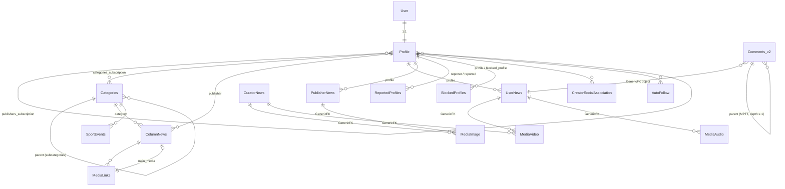

# 4. Data Model

[← Contents](README.md)

## Overview



## Users (`api/models/profiles.py`)

### `Profile`
Extends the standard `django.contrib.auth.User` (1:1). It is created automatically by the `post_save(User)` signal.

| Field | Description |
|---|---|
| `global_id` | Public UUID |
| `name`, `bio`, `website`, `phone`, `gender`, `birthday_date`, `timezone` | Profile data |
| `profile_photo`, `profile_photo_svg` | Avatar (S3) |
| `is_source` | Publisher (news source) |
| `is_creator` | Creator |
| `is_approved` | Verified account |
| `account_rate` | Account rating (computed by other services) |
| `personal_link` | Firebase Dynamic Link to the profile (filled by cron) |
| `signup_code` | Code used at sign-up |
| `categories_subscription`, `publishers_subscription` | M2M follows |
| `have_access_to_vylo_props`, `dfs_pre_auth_completed`, `creator_cash` | DFS feature access |

### Supporting models
| Model | Purpose |
|---|---|
| `DraftProfile` | Email + confirmation code before full registration (3 attempts) |
| `ResetCode` | 6-digit password reset code (3 attempts, 30-minute TTL) |
| `WhitelistedUsernames` | Reserved usernames |
| `ReportedProfiles` | One profile reporting another |
| `BlockedProfiles` | Blocks (`i_block_users` / `users_block_me`) |
| `AutoFollow` | Accounts every new user follows automatically (ordered by `sort_order`) |
| `CreatorSocialAssociation` | Creator's connected socials (instagram / tiktok / youtube) |
| `BetaUsers`, `BetaRefCode` | Legacy invite-code beta access (endpoints disabled) |

## Categories (`api/models/categories.py`)

`Categories` is a tree (FK `parent`) of main categories and subcategories. Fields: `name`, `code`, `order`, `filter_order`,
`category_type`, `is_active`, `is_optional`, `odds_type`. **The Admin API is the source of truth.** Categories arrive here through the
`move_category2column` task.

## Content v1 (`api/models/news.py`)

### `ColumnNews`
A single table for all first-generation posts.

| Status | Meaning |
|---|---|
| 1 | Draft: created when a presigned URL was requested, not yet published |
| 2 | Published: published by the user, waiting for moderation |
| 3 | Approved: passed moderation |
| 4 | Declined: rejected, or a report was upheld |
| 5 | Deleted |

Replies use `response_to` (UUID) + `response_type` (`1` News, `2` Sport events, `3` Comments).
Lineups use `lineup_global_id` and `lineup_data` (a JSON snapshot of the lineup from vylo-bets).
`events_counter` is a JSON object with event counters (views, likes, etc.) computed by the Events service.

### Others
`MediaLinks` (v1 post media), `NewsReport` (post report), `Comments` (v1 comments), `ShareIntroEvents`
(social sharing), `GlobalSearchTrending` (trending queries).

## Content v2 (`api_v2/models`)

### Post hierarchy

```
BasicNews (abstract, PolymorphicModel)
├── PublisherNews   allowed_media = [image]         statuses: 2 Published, 3 Approved
├── UserNews        allowed_media = [video, audio]  statuses: 1 Draft … 5 Deleted, + lineup_global_id
└── CuratorNews     allowed_media = [image, video]  type: Text / Avatar / Photo / Video
                                                    profile (JSON), main_prop, props (JSON)
```

- `GlobalIDManager.is_global_id_unique()` guarantees that `global_id` is unique **across all three tables**. The check runs in `save()`.
- `GlobalIDManager.get_news_obj(global_id)` finds a post of any type.
- `main_media` is the first media item with `is_main=True` among the types allowed for that post class.

### Media

```
MediaBase (abstract, PolymorphicModel; GenericFK content_object)
├── MediaImage   → bucket AWS_NEWS_STORAGE_BUCKET_NAME,        key {global_id}/{global_id}.{ext}
└── MediaFile (abstract: content, thumbnail, duration, get_presigned_url())
    ├── MediaVideo → content: AWS_VIDEO_UPLOAD_BUCKET          key {global_id}/{global_id}.mp4
    │                thumbnail: AWS_VIDEO_UPLOAD_BUCKET_OPTIMIZED  {global_id}/thumbs-{global_id}-00002.{ext}
    └── MediaAudio → AWS_AUDIO_UPLOAD_BUCKET                   audios/{global_id}/{global_id}.mp3
```

Client-facing URLs go through the CDN: `https://{AWS_S3_CUSTOM_DOMAIN}/…` for images and `https://{AWS_S3_AUDIOVIDEO_CUSTOM_DOMAIN}/…`
for video and audio.

### Comments (`Comments`, MPTT)
- GenericFK `object` points to a post of any type.
- `parent` builds the tree. `clean()` forbids nesting deeper than 1 level (comment → reply, nothing deeper).
- `response_to_comment` records which comment in the thread was replied to.
- `user_news` (1:1): a comment can be a video reply (`UserNews`).
- `lineup_global_id`: a comment with an attached lineup.

### `Reports`
A report on any object (GenericFK). The *(profile, object)* pair is unique.

## Sports (`api/models/sportsbook.py`)

`SportEvents` is a match: teams, logos, score, `market` (JSON odds), `commence_time`, `is_completed`.
Its source is the Admin API (task `update_or_create_event`).
